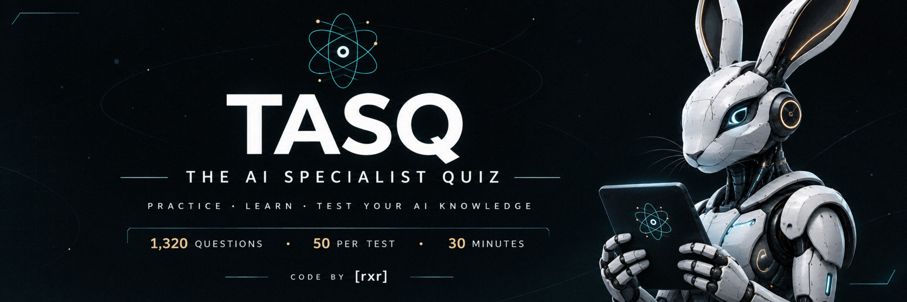
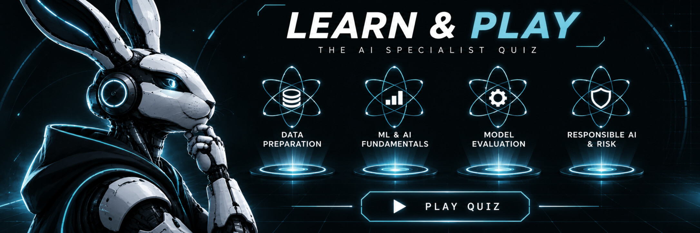
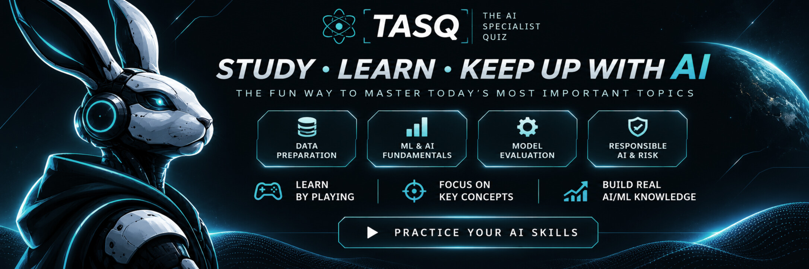
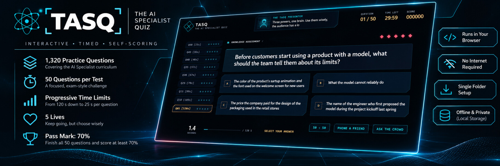
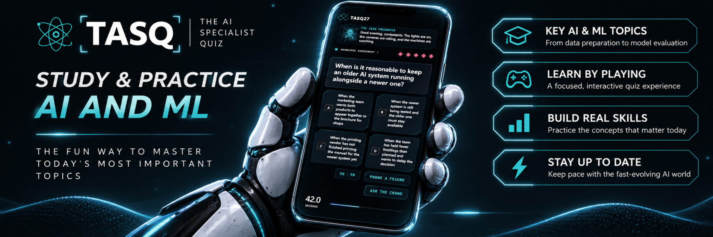
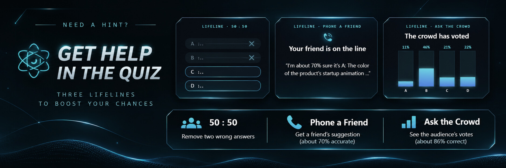

<div align="center">



# 🧠 TASQ · The AI Specialist Quiz

**A timed, self-scoring AI quiz in the spirit of *Who Wants to Be a Millionaire* – 1,320 questions, 3 lifelines, 5 lives, zero setup.**


[**▶️ Play online**](#play-online) · [**🎯 About**](#what-is-it) · [**✨ Features**](#features) · [**🕹️ How to play**](#how-to-play) · [**🚀 Run locally**](#run-it-locally) · [**🙏 Credits**](#credits)

</div>

---

TASQ is a browser quiz for people learning or brushing up on **AI and machine-learning fundamentals**. You get a 50-question test with a ticking clock, a lives system, a game-show presenter and three lifelines (50:50, Phone a Friend, Ask the Crowd). It is built with plain HTML, CSS and JavaScript, so there is no server, no account, no build step and no internet connection needed. Download the folder, open `index.html`, play.

<a id="play-online"></a>

## ▶️ Play online

<div align="center">

</div>

You don't have to download anything to try TASQ. A hosted demo will let you play straight from your browser, on desktop or phone.

| | |
|---|---|
| 🌐 **Live demo** | `TBD` – link coming soon |
| 💻 **Prefer offline?** | See [Run it locally](#run-it-locally) |

<div align="center">

</div>

<a id="what-is-it"></a>

## 🎯 What is it?

The question bank follows the kind of material found in AI specialist certification curricula (including the Pearson IT certificate), grouped into four areas:

| Topic | What you get tested on |
|---|---|
| 🗄️ **Data preparation** | cleaning, feature engineering, splits, leakage |
| 📈 **ML & AI fundamentals** | core concepts, model types, training basics |
| ⚙️ **Model evaluation** | metrics, validation, monitoring and oversight |
| 🛡️ **Responsible AI & risk** | bias, transparency, risk and impact assessment |

<div align="center">

</div>

> All questions are **original practice questions** written for this project. They are not official exam content, and TASQ is not affiliated with or endorsed by Pearson or any other certification body.

<a id="features"></a>

## ✨ Features

<div align="center">

</div>

- 📚 **1,320 practice questions**, 50 drawn at random for each test
- ⏱️ **Progressive time limits** – from 120 s per question down to 25 s
- ❤️ **5 lives** – a wrong or timed-out answer costs one
- 🆘 **3 lifelines**, each usable once per test
- 🎙️ **The TASQ Presenter** comments on your answers and milestones
- 🪜 **Question ladder** with 10 rungs and star ratings per round
- 🏆 **Scoring with speed bonus** and a personal-best record
- 🌌 **Animated 3D background** (three.js / WebGL)
- 🔒 **Offline and private** – records live only in your browser's local storage

## 💡 Why TASQ?

<div align="center">

</div>

- 🎓 **Key AI & ML topics** – from data preparation to model evaluation
- 🎮 **Learn by playing** – a focused, interactive quiz instead of a dry question list
- 📊 **Build real skills** – practise the concepts that matter today
- ⚡ **Stay up to date** – keep pace with the fast-evolving AI world

Because it's a single static page, it also opens in a phone browser, with a simplified layout.

<a id="run-it-locally"></a>

## 🚀 Run it locally

No coding or installation needed. Pick whichever way is easiest:

**Option 1 – Download as ZIP (easiest)**
1. Click the green **Code** button at the top of this repo, then **Download ZIP**.
2. Unzip the folder anywhere on your computer.
3. Open `index.html` in your browser.

**Option 2 – Clone with Git** (if you already use it)

```bash
git clone https://github.com/rxr20/TASQ.git
cd TASQ
```

Then open `index.html` in a modern browser.

Once it's open, press **Enter** (or tap) on the splash screen, then choose **PLAY**.

<a id="how-to-play"></a>

## 🕹️ How to play

1. **Select** an answer by clicking it or pressing `A` `B` `C` `D` (or `1`–`4`).
2. **Lock it in** with **FINAL ANSWER** or `Enter`. It turns green if right, red if wrong, and the correct answer is revealed.
3. Move on with **NEXT QUESTION**, or wait for the short automatic pause.
4. Survive all **50 questions** within the **30-minute** overall clock and keep **5 lives** to the end.

If a question's timer runs out, your selected answer is checked as normal. With nothing selected, it counts as wrong and costs a life.

### ⏳ The clock gets tighter

Questions come in 10 rounds of five. The deeper you go, the less time you get.

| Questions | Time each | Questions | Time each |
|---|---|---|---|
| Q01–05 | 120 s | Q26–30 | 67 s |
| Q06–10 | 109 s | Q31–35 | 57 s |
| Q11–15 | 99 s | Q36–40 | 46 s |
| Q16–20 | 88 s | Q41–45 | 36 s |
| Q21–25 | 78 s | Q46–50 | **25 s** |

### 🆘 Lifelines

<div align="center">

</div>

| Lifeline | Key | Effect |
|---|:-:|---|
| **50 : 50** | `F` | Removes two of the three wrong answers |
| **Phone a Friend** | `P` | A friend suggests an answer – right about **70%** of the time |
| **Ask the Crowd** | `C` | Audience vote chart – the top vote is correct about **86%** of the time |

Each can be used **once per test**, before you lock in an answer. The two popups pause the clocks until you press **CONTINUE**.

### 🏅 Scoring and passing

- ✅ Correct answer: **500 points** + up to **500 speed bonus** (the faster, the more)
- ❌ Wrong or unanswered: **0 points**
- 🎓 **Pass mark: 70%** – you must finish all 50 questions and answer at least 70% correctly. Otherwise the result screen tells you why: out of lives, out of time, or below the pass mark.

### ⌨️ Keyboard shortcuts

| Key | Action |
|:-:|---|
| `Enter` / `Space` | Leave the splash screen |
| `A`–`D` or `1`–`4` | Select an answer |
| `Enter` | Final answer |
| `F` · `P` · `C` | 50:50 · Phone a Friend · Ask the Crowd |

## 🗂️ Project structure

| Path | What it is |
|---|---|
| `index.html` | The page: splash, menu, test, result, records and settings screens |
| `core/main.js` | Game logic: flow, timers, scoring, lifelines, presenter, records |
| `core/main.css` | Styles |
| `core/quiz-bank.js` | The question bank, embedded so it works offline |
| `core/libs/` | Bundled third-party libraries |
| `quizes/it-ai-specialist-quiz.csv` | The question bank as CSV (source of `quiz-bank.js`) |
| `images/` | README banners |

<details>
<summary><b>➕ Add or edit questions</b></summary>

<br>

The bank is a CSV with one header row and one question per row, six quoted fields:

```csv
"question","correct answer","wrong answer1","wrong answer2","wrong answer3","wrong answer4"
```

Each question in a test shows the correct answer plus three randomly chosen wrong ones, in random order. `core/quiz-bank.js` is generated from this CSV so the game works straight from the file system.

</details>

## 🛠️ Tech stack

`HTML5` · `CSS3` · `JavaScript (ES6)` · `three.js` · `Bootstrap` · `jQuery` · `Web Audio` · `localStorage`

<a id="credits"></a>

## 🙏 Credits

TASQ bundles these open-source libraries in [`core/libs`](core/libs). Thank you to their authors and maintainers.

| Library | Version | Used for | Licence |
|---|:-:|---|---|
| [three.js](https://threejs.org/) | r150 | Animated 3D background | MIT |
| [Bootstrap](https://getbootstrap.com/) | 5.3.3 | Layout and base styles | MIT |
| [jQuery](https://jquery.com/) | 3.7.1 | DOM handling | MIT |

Banner artwork and the quiz were created by **[rxr](https://github.com/rxr20)**.

## ⚠️ Notes

- The 3D background needs WebGL; the quiz itself works without it.
- Sound needs a browser that allows audio after a click or key press.
- Designed for desktop widths. On narrow screens the ladder is hidden and the layout is simpler. Phone support hasn't been tested on many real devices yet.
- Debug mode: open `index.html#debug` for a one-question test (never counted in records).

---

<div align="center">

*Practice · Learn · Test your AI knowledge*

</div>
